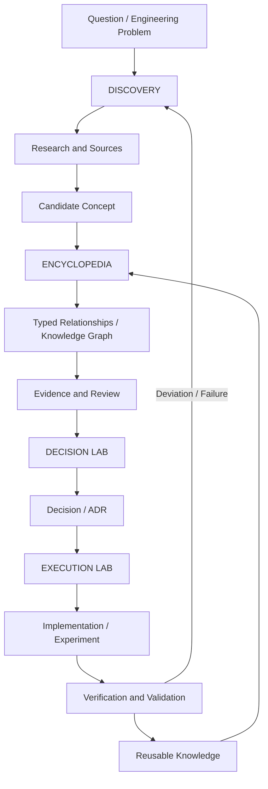

# EKTA
## Engineering Knowledge & Techniques Atlas

**اطلس جامع دانش، مفاهیم، معماری‌ها، روش‌ها و فنون مهندسی**

[English](#english) · [فارسی](#معرفی-پروژه) · [Master Handoff](docs/MASTER_HANDOFF.md)

<blockquote>
EKTA یک اطلس مهندسی رابطه‌مند، چندلایه و مبتنی بر شواهد است؛ برای اینکه دانش مهندسی فقط خوانده و ذخیره نشود، بلکه قابل کشف، فهم، اتصال، ارزیابی، تصمیم‌گیری، اجرا و اعتبارسنجی باشد.
</blockquote>

| مشخصه | وضعیت |
|---|---|
| نام کامل | Engineering Knowledge & Techniques Atlas |
| مخزن رسمی | [metsam-mastem/EKTA](https://github.com/metsam-mastem/EKTA) |
| شاخه اصلی | `main` |
| منشور و چشم‌انداز | **APPROVED — 2026-11-23** |
| نوع محصول | Engineering Knowledge Operating Environment |
| وضعیت توسعه | Runtime v0.2 + Operational Workspace v0.4 — parallel subsystem foundations in review |
| مجوز مخزن | هنوز انتخاب نشده است |

---

## Orchestration and active development

- [Active workstreams and execution order](docs/ORCHESTRATION/ACTIVE_WORKSTREAMS.md)
- [Cross-subsystem integration matrix](docs/ORCHESTRATION/INTEGRATION_MATRIX.md)
- [Machine-readable workstream registry](orchestration/WORKSTREAMS.yml)

The orchestration registry tracks ten active product workstreams and the pinned GTC external integration. GTC source remains in its upstream repository under integrations/gtc; it is not copied or re-licensed. The registry does not approve or merge open PRs. Every subsystem remains isolated until exact-head CI, contract review, and owner approval.

## معرفی پروژه

EKTA قرار نیست صرفاً یک واژه‌نامه یا مجموعه‌ای از فایل‌های Markdown باشد. هدف، ساخت یک محیط دانش مهندسی است که مفاهیم، تکنیک‌ها، الگوها، استانداردها، ابزارها، معماری‌ها، پیاده‌سازی‌ها و شواهد را به هم متصل می‌کند.

در EKTA، یک اصطلاح مانند `Runtime` فقط یک تعریف ندارد. باید بتوان آن را در لایه‌های سخت‌افزار، Firmware، سیستم‌عامل، پلتفرم، اپلیکیشن، گردش کار، عامل هوشمند و خط پردازش بررسی کرد؛ تفاوت نقش‌ها و سازوکارها را شناخت؛ نمونه‌های پیاده‌سازی را دید؛ محدودیت‌ها را سنجید؛ و در نهایت از دانش به یک تصمیم یا دستورالعمل اجرایی رسید.

### مسیر اصلی ارزش

`Discover → Understand → Connect → Evaluate → Decide → Build → Verify → Learn`

یا به فارسی:

**کشف → فهم → اتصال → ارزیابی → تصمیم → ساخت → اعتبارسنجی → یادگیری**

### چهار منطقه اصلی محصول

| منطقه | مسئولیت | خروجی |
|---|---|---|
| **01 — DISCOVERY** | کشف مسئله، تحقیق، بررسی منابع و استخراج مفاهیم | پژوهش‌ها، منابع، مفاهیم کاندید |
| **02 — ENCYCLOPEDIA** | تعریف و نگهداری دانش ساخت‌یافته و روابط | شناسنامه مفاهیم، واژه‌نامه، طبقه‌بندی و نقشه‌ها |
| **03 — DECISION LAB** | مقایسه گزینه‌ها، تحلیل ریسک و Trade-off | ماتریس مقایسه، تصمیم مهندسی و ADR |
| **04 — EXECUTION LAB** | تبدیل دانش و تصمیم به اقدام مهندسی | Playbook، نمونه‌سازی، آزمون و شواهد اجرا |

### چرخه End-to-End



---

## معماری طبقه‌بندی دانش

EKTA سه محور طبقه‌بندی مستقل دارد؛ در کنار آن‌ها یک لایه ناوبری سطح‌بالا برای ۲۶ قلمرو مهندسی قرار دارد. قلمرو کلان با حوزه تخصصی یکی نیست و این دو فهرست نباید با هم جایگزین شوند.

| محور | پرسش | نمونه |
|---|---|---|
| **Engineering Territory** | در کدام قلمرو کلان و مسیر ناوبری قرار داریم؟ | ۲۶ قلمرو مصوب در `taxonomy/territories.yml` |
| **Engineering Domain** | کدام حوزه تخصصی دانش را توصیف می‌کند؟ | Software، Hardware، Systems، Robotics؛ ۲۵ شناسه عملیاتی در `taxonomy/domains.yml` |
| **Engineering Layer** | مفهوم در کدام لایه سیستم قرار دارد؟ | Physical، Firmware، OS، Platform، Application، Workflow |
| **Knowledge / Technique Type** | با چه نوع دانشی روبه‌رو هستیم؟ | Concept، Architecture، Mechanism، Algorithm، Pattern، Method، Standard، Tool |

یک مفهوم می‌تواند به چند حوزه تخصصی، قلمرو مشتق‌شده و لایه مرتبط باشد، اما باید هویت canonical و شناسه پایدار خود را حفظ کند. نگاشت قلمروها از طریق `domain_ids` در رجیستری قلمروها انجام می‌شود.

### نقشه مادر قلمروهای مهندسی

ناوبری سطح‌بالای اطلس در ۲۶ قلمرو مهندسی سازمان‌دهی شده است. این شمار، قلمروهای کلان است و با شمار حوزه‌های تخصصی عملیاتی تفاوت دارد:

1. علوم و ریاضیات مهندسی
2. مهندسی سیستم‌ها
3. مهندسی نرم‌افزار
4. علوم کامپیوتر
5. سیستم‌عامل و مهندسی پلتفرم
6. مهندسی داده و پایگاه داده
7. شبکه و مخابرات
8. سیستم‌های توزیع‌شده و زیرساخت ابری
9. هوش مصنوعی، یادگیری ماشین و عامل‌ها
10. الکترونیک و نیمه‌رسانا
11. معماری کامپیوتر و مهندسی پردازنده
12. طراحی تراشه
13. طراحی برد و سامانه‌های الکترونیکی
14. Firmware و سیستم‌های تعبیه‌شده
15. مکانیک، مواد و ساخت
16. رباتیک، کنترل و مکاترونیک
17. امنیت، ایمنی و تاب‌آوری
18. آزمون، Verification، Validation و تضمین کیفیت
19. مهندسی گردش کار و فرایند
20. مهندسی اتوماسیون
21. UX، UI و تعامل انسان و ماشین
22. عملیات و قابلیت اطمینان
23. مهندسی محصول
24. مهندسی پروژه و مدیریت فرایند توسعه
25. مستندسازی، استانداردها و حاکمیت مهندسی
26. قلمروهای کاربردی و میان‌رشته‌ای

این نقشه یک طبقه‌بندی مادر برای پیمایش است؛ پوشش کامل هر قلمرو مستلزم توسعه زیرشاخه‌ها و ثبت شناسنامه‌های مستقل و مستند است.

---

## شناسنامه مهندسی هر مفهوم

هر مفهوم باید با شناسه پایدار و ساختار استاندارد ثبت شود. شناسنامه مفهومی باید دست‌کم این ابعاد را پوشش دهد:

- **Identity:** نام canonical، شناسه، نام‌های مستعار و معادل فارسی
- **Definition:** تعریف، مرز مفهومی و موارد خارج از دامنه
- **Classification:** قلمرو، لایه، نوع دانش و خانواده
- **Purpose & Role:** مسئله، چرایی و مسئولیت معماری
- **Architecture:** اجزا، مرزها و رابط‌ها
- **Mechanism & Lifecycle:** سازوکار، حالت‌ها، توالی و چرخه عمر
- **Input / Output:** ورودی، خروجی، رویداد و خطا
- **Dependencies & Relations:** وابستگی‌ها و روابط نوع‌دار
- **Patterns & Techniques:** الگوها، روش‌ها و فنون
- **Implementations:** پروژه‌ها، ابزارها، نسخه‌ها و مخازن
- **Properties & Trade-offs:** عملکرد، قابلیت اطمینان، هزینه، انرژی و محدودیت‌ها
- **Verification:** روش آزمون، اندازه‌گیری و اعتبارسنجی
- **Evidence & Provenance:** منبع، تاریخ، نسخه، سطح اطمینان و شرایط استفاده

### مدل گراف دانش

روابط پایه شامل `IS-A`, `PART-OF`, `USES`, `DEPENDS-ON`, `IMPLEMENTS`, `EXTENDS`, `CONTROLS`, `EXECUTES`, `SCHEDULES`, `OBSERVES`, و `COMPETES-WITH` هستند.

گراف کامل باید هم Node و هم Edge داشته باشد. خروجی صرفاً شامل Nodeها، فهرست مفاهیم است و نباید Knowledge Graph کامل معرفی شود.

---

## معماری محصول و پلتفرم

اصل معماری: **مدل دانش، هسته محصول است؛ رابط‌ها و ابزارها مصرف‌کننده آن هستند.**

```text
User Interfaces
Web / Desktop / Android / CLI / API / AI
                 |
                 v
Application Layer
Explore / Search / Compare / Review / Decide / Execute
                 |
                 v
Knowledge Services
Taxonomy / Concepts / Graph / Evidence / Provenance
                 |
                 v
Canonical Knowledge Store
Git-native files + structured metadata
                 |
                 v
Validation and Build Pipeline
Schemas / IDs / Links / Relations / Tests / CI
```

### مسیر تکامل پیشنهادی

1. **Git-native Foundation:** اسناد نسخه‌پذیر، شناسه پایدار، Schema و اعتبارسنج خودکار.
2. **Static Web Portal:** جست‌وجو، فیلتر، پیمایش قلمروها و صفحه مستقل مفاهیم.
3. **Local-first Atlas:** Snapshot آفلاین، جست‌وجوی محلی و گراف قابل حمل.
4. **Interactive Workbench:** مقایسه، ADR، Playbook و ثبت شواهد اجرا.
5. **AI-assisted Interface:** بازیابی مستند، پاسخ همراه ارجاع و تأیید انسانی.

این‌ها مراحل پیشنهادی توسعه‌اند؛ وجودشان در نقشه راه به معنی پیاده‌سازی‌شدن نیست.

---

## ساختار دانش و مخزن

سه مجموعه دانشی باید از نظر مسئولیت تفکیک شوند و از طریق شناسه‌ها و روابط به هم متصل بمانند:

1. **Master Taxonomy:** قلمروها، زیرشاخه‌ها، لایه‌ها، انواع دانش و واژگان کنترل‌شده.
2. **Concept Encyclopedia:** شناسنامه مفاهیم، سازوکار، نقش، معماری، پیاده‌سازی و روابط.
3. **Engineering Practice Library:** تکنیک‌ها، روش‌ها، الگوها، استانداردها، ابزارها، آزمایش‌ها و Playbookها.

ساختار منطقی مخزن:

```text
EKTA/
├── README.md
├── PROJECT_CHARTER.md
├── CONTRIBUTING.md
├── GOVERNANCE.md
├── docs/
│   ├── MASTER_HANDOFF.md
│   ├── PROJECT_GUIDE.md
│   ├── REPOSITORY_MAP.md
│   ├── ARCHITECTURE.md
│   ├── KNOWLEDGE_ARCHITECTURE.md
│   ├── CONTEXT_CONTINUITY.md
│   ├── LIFECYCLE.md
│   ├── QUALITY_GATES.md
│   ├── ROADMAP.md
│   ├── GLOSSARY.md
│   └── VISION_AND_PRODUCT_STORY.md
├── taxonomy/
├── encyclopedia/
│   ├── concepts/
│   ├── techniques/
│   ├── methods/
│   ├── patterns/
│   ├── standards/
│   └── implementations/
├── maps/
├── schemas/
├── research/
├── references/
├── templates/
├── tools/
├── tests/
└── .github/workflows/
```

این درخت، معماری منطقی هدف است. وجود یک مسیر در نمودار به معنی وجود فایل یا قابلیت اجرایی در مخزن نیست؛ وضعیت واقعی باید با Git tree و CI بررسی شود.

---

## منابع و راهبرد پژوهش

EKTA باید منابع هنجاری، مستندات رسمی، پژوهش دانشگاهی و پیاده‌سازی‌های قابل بررسی را با هم به کار گیرد.

منابع مرجع اولیه:

- [IEEE SWEBOK](https://www.computer.org/education/bodies-of-knowledge/software-engineering/topics) — دانش مهندسی نرم‌افزار
- [SEBoK](https://sebokwiki.org/wiki/SEBoK_Introduction) — دانش مهندسی سیستم‌ها
- [NASA Systems Engineering Handbook](https://www.nasa.gov/reference/systems-engineering-handbook/) — چرخه عمر، طراحی و اعتبارسنجی سیستم
- [Linux Kernel Documentation](https://www.kernel.org/doc/html/latest/) — سازوکارهای سیستم‌عامل و کرنل
- [RISC-V Specifications](https://docs.riscv.org/) — معماری مجموعه دستورالعمل و مشخصات پردازنده
- [NIST SSDF](https://csrc.nist.gov/pubs/sp/800/218/final) — توسعه امن نرم‌افزار
- [Nature Index — Ontology Engineering and Semantic Knowledge Systems](https://www.nature.com/nature-index/topics/l4/ontology-engineering-and-semantic-knowledge-systems) — هستی‌شناسی و سامانه‌های دانش معنایی
- [GitLab Orbit Architecture](https://handbook.gitlab.com/handbook/engineering/architecture/design-documents/orbit/) — مطالعه ساخت گراف از اطلاعات مهندسی و مخزن
- [Engineering Knowledge Framework](https://github.com/dhruvasagar/engineering-knowledge-framework) — مرجع متن‌باز برای سازمان‌دهی دانش مهندسی
- [Digital Thread Review — Systems (2024)](https://www.mdpi.com/2079-8954/12/3/70) — تداوم اطلاعات مهندسی
- [Ontology of Systems Engineering](https://www.sciencedirect.com/science/article/pii/S1877050919307380) — هستی‌شناسی مهندسی سیستم‌ها

هر منبع باید از نظر اعتبار، تاریخ، نسخه، دامنه کاربرد، روش و مجوز استفاده بررسی شود. فهرست‌شدن یک منبع به معنی تأیید تمام ادعاهای آن نیست.

---

## وضعیت، حاکمیت و کیفیت

### وضعیت منشور

**APPROVED — 2026-11-23:** منشور و چشم‌انداز فعلی پروژه با تأیید صریح مالک پروژه تصویب شدند.

این تأیید به‌تنهایی به معنی انتخاب فناوری نهایی، مجوز، میزبان، موتور گراف یا پیاده‌سازی قابلیت‌های آینده نیست.

### واژگان وضعیت

| Status | معنی |
|---|---|
| `PROPOSED` | پیشنهادشده، هنوز تصویب یا راستی‌آزمایی نشده |
| `RESEARCHED` | بررسی‌شده با منابع، اما هنوز تأیید مستقل نشده |
| `VERIFIED` | ادعا در محدوده مشخص با شواهد کافی بررسی شده |
| `IMPLEMENTED` | پیاده‌سازی در مخزن یا سامانه مشخص وجود دارد |
| `VALIDATED` | معیار پذیرش و آزمون در شرایط ثبت‌شده پاس شده |
| `NOT_RUN` | بررسی لازم هنوز اجرا نشده |
| `BLOCKED` | کار متوقف است و علت/شرط رفع مانع باید ثبت شود |
| `DEPRECATED` | منسوخ یا جایگزین‌شده، با حفظ سابقه |

### اصول حاکمیتی

- EKTA پروژه‌ای مستقل است؛ ادغام با پروژه‌های دیگر فقط با دستور صریح مالک.
- ادعا، پیشنهاد، تحقیق، پیاده‌سازی و اعتبارسنجی باید از هم جدا باشند.
- هیچ آزمون، منبع، فایل، قابلیت یا استقراری نباید جعل یا بدون مدرک تکمیل‌شده اعلام شود.
- برای استفاده از کد، داده یا نمودار خارجی، مجوز و انتساب باید بررسی شود.
- مجوز خود مخزن EKTA هنوز تعیین نشده است؛ عمومی‌بودن مخزن به‌تنهایی حق بازاستفاده ایجاد نمی‌کند.
- تغییرات مهم معماری، Taxonomy، Schema و Governance باید سابقه تصمیم و شواهد داشته باشند.

---

## نقشه راه اجرایی

| فاز | تمرکز | خروجی قابل پذیرش |
|---|---|---|
| 0 | تثبیت منشور و مبانی | منشور، Handoff، نقشه مخزن و حاکمیت |
| 1 | Taxonomy و قرارداد داده | طبقه‌بندی ۲۶ قلمرو، Schema و شناسه‌ها |
| 2 | دانشنامه هسته | مفاهیم Runtime، Engine، Scheduler، Controller، Manager و خانواده مرتبط |
| 3 | گراف دانش | استخراج Node و Edge، اعتبارسنجی روابط و خروجی بازتولیدپذیر |
| 4 | کتابخانه عمل مهندسی | روش‌ها، استانداردها، ابزارها، منابع و Playbook |
| 5 | پورتال وب | پیمایش، جست‌وجو، فیلتر و صفحه مفاهیم |
| 6 | Workbench و Local-first | مقایسه، ADR، اجرای Playbook و استفاده آفلاین |
| 7 | رابط هوشمند | Retrieval مستند، ارجاع، بسته کانتکست و تأیید انسانی |

**اولویت فوری:** قبل از تولید انبوه مفاهیم، Taxonomy، Schema و اعتبارسنج رابطه‌ها را تثبیت کن. کیفیت ساختار بر تعداد رکوردها مقدم است.

---

## نقطه شروع برای ادامه کار

**سند اصلی تحویل پروژه:** [Master Project Handoff](docs/MASTER_HANDOFF.md)

این سند شامل مأموریت، معماری محصول، نقشه ۲۶ قلمرو، سه محور Taxonomy، لایه‌های مهندسی، مدل مفهومی و گراف، معماری اجرایی، ساختار مخزن، راهبرد منابع، معیارهای کیفیت، Roadmap و پروتکل تحویل به توسعه‌دهنده یا عامل بعدی است.

### اسناد کلیدی

- [Project Charter](docs/PROJECT_CHARTER.md)
- [Vision & Product Story](docs/VISION_AND_PRODUCT_STORY.md)
- [Knowledge Architecture](docs/KNOWLEDGE_ARCHITECTURE.md)
- [Master Taxonomy](taxonomy/MASTER_TAXONOMY.md)
- [Concept Schema](schemas/CONCEPT_SCHEMA.md)
- [Repository Map](docs/REPOSITORY_MAP.md)
- [Context Continuity](docs/CONTEXT_CONTINUITY.md)
- [Roadmap](docs/ROADMAP.md)
- [Governance](docs/GOVERNANCE.md)

### دستورالعمل شروع برای هر مشارکت‌کننده یا AI Agent

1. ابتدا [Master Handoff](docs/MASTER_HANDOFF.md)، منشور و Governance را بخوان.
2. وضعیت واقعی مخزن، فایل‌ها، Branch، Commit و CI را بررسی کن.
3. قبل از ساخت مفهوم جدید، شناسه‌ها و روابط موجود را جست‌وجو کن.
4. تغییرات را کوچک، قابل بازبینی و مستند انجام بده.
5. اعتبارسنج‌ها و آزمون‌های مرتبط را اجرا کن.
6. فایل‌های تغییرکرده، شواهد، Commit، محدودیت‌ها و گام بعدی را گزارش کن.
7. وضعیت تأییدنشده را به‌عنوان قابلیت پیاده‌سازی‌شده معرفی نکن.

---

## English

EKTA is an independent, evidence-backed Engineering Knowledge Operating Environment. It connects a multidimensional engineering taxonomy, canonical concept records, a typed knowledge graph, research sources, implementation references, engineering decisions, and executable practices.

Its four workspaces are **DISCOVERY**, **ENCYCLOPEDIA**, **DECISION LAB**, and **EXECUTION LAB**. Its classification model keeps **Engineering Domain**, **Engineering Layer**, and **Knowledge / Technique Type** as separate axes. The master map spans 26 engineering territories.

The primary implementation strategy is Git-native and schema-driven first, followed by a searchable web portal, local-first atlas, interactive engineering workbench, and source-grounded AI interface. These are staged directions, not claims of completed implementation.

**Start with:** [Master Project Handoff](docs/MASTER_HANDOFF.md).

---

**Canonical repository:** https://github.com/metsam-mastem/EKTA  
**Project status:** Charter and product vision approved on 2026-11-23  
**License:** Undecided  
**Current source of truth:** Git history and the files present in this repository


## شروع مستقل و مستندات کاربر

برای استفاده از EKTA نیازی به مشاهده مکالمه‌های قبلی یا استفاده از ChatGPT نیست. مخزن GitHub منبع حقیقت پروژه است.

**از اینجا شروع کنید:** [فهرست مستندات کاربر](docs/USER_DOCUMENTATION_INDEX.md)  
**میزکار عملیاتی:** [راه‌اندازی، خودآزمایی، ورود دانش، پیش‌نویس، پشتیبان و مستندات](http://127.0.0.1:8000/workspace)  
**راهنمای میزکار:** [WORKSPACE_GUIDE.md](docs/WORKSPACE_GUIDE.md) و [مدل امنیت و مرحله‌بندی](docs/SECURITY_AND_STAGING_MODEL.md)

- [معرفی پروژه: چیستی، چرایی، معماری و کاربردها](docs/PROJECT_OVERVIEW.md)
- [User Setup — آماده‌سازی پیش از نصب](docs/USER_SETUP.md)
- [User Installation — نصب و راه‌اندازی](docs/USER_INSTALLATION.md)
- [User Manual — راهنمای جامع کاربری](docs/USER_MANUAL.md)
- [Input Guide — انواع ورودی و روش افزودن دانش](docs/INPUT_GUIDE.md)
- [Independence & Recovery — استقلال از چت و بازیابی](docs/INDEPENDENCE_AND_RECOVERY.md)
- [Troubleshooting — عیب‌یابی](docs/TROUBLESHOOTING.md)
- [Agent Onboarding — ادامه مستقل توسط توسعه‌دهنده یا AI](docs/AGENT_ONBOARDING.md)

اجرای محلی:
- Windows PowerShell: `powershell -ExecutionPolicy Bypass -File scripts/start.ps1`
- Linux/macOS: `sh scripts/start.sh`

سپس http://127.0.0.1:8000 را باز کنید. مستندات API در /docs قرار دارد.

**محدودیت نسخه 0.2:** رابط فعلی read-only است. آپلود فایل، ویرایش مستقیم شناسنامه، جست‌وجوی معنایی/AI، حساب کاربری، بسته Android و استقرار عمومی در این نسخه وجود ندارد. برای جزئیات به User Manual و Input Guide مراجعه کنید.

## Operational Workspace (v0.4)

The local workspace at `/workspace` provides first-run onboarding, repository self-test, Markdown/YAML/JSON intake staging, Git-separated concept drafts, ZIP backup export, safe restore preview staging, and a Markdown documentation center. It does not write canonical knowledge or automatically restore files. See [Workspace Guide](docs/WORKSPACE_GUIDE.md).

## Search and Explore Workbench (v0.2)

The local runtime now provides a unified discovery surface across concept identity records and indexed project documents. The browser experience is Persian-first and right-to-left, while IDs, taxonomy keys, source paths, and technical terms retain their original forms.

### Search syntax

| Input | Purpose |
|---|---|
| `runtime engine` | Search all terms across names, aliases, headings, and content |
| `#runtime` | Match a hashtag derived from concept names, aliases, taxonomy, headings, and content tags |
| `"workflow runtime"` | Search an exact phrase |
| `territory:software-engineering` | Filter by one of the 26 approved top-level territories |
| `domain:software-engineering` | Filter by operational engineering domain |
| `layer:platform-runtime` | Filter by engineering layer |
| `type:concept` | Filter by knowledge type |
| `status:PROPOSED` | Filter by record maturity status |
| `kind:document` | Filter by result kind: concept, document, taxonomy, or schema |
| `id:EKTA-CON-000001` | Look up a stable record ID |

Multiple words are AND-matched. Query fields can be combined, for example:
`runtime territory:software-engineering layer:platform-runtime status:PROPOSED`.

### Discovery API

- `GET /api/v1/search?q=...` — unified, ranked results and snippets.
- `GET /api/v1/facets` — territory, domain, layer, type, status, and tag facets.
- `GET /api/v1/concepts/{id}` — full concept identity card and graph relationships.
- `GET /api/v1/documents/{id}` — scoped full document content by generated stable document ID.
- `GET /api/v1/taxonomy` — canonical taxonomy registries.

### Taxonomy clarification

EKTA now separates **26 top-level Engineering Territories** from **25 operational domain tags**. Territories are the navigation/portfolio layer; operational domains are more granular classification values. The explicit mapping is in [taxonomy/territories.yml](taxonomy/territories.yml), and domain identifiers remain in [taxonomy/domains.yml](taxonomy/domains.yml). This removes the earlier 22-vs-26 ambiguity without treating the two lists as interchangeable.
