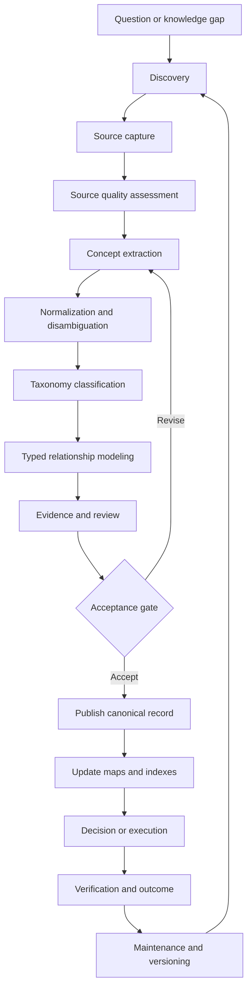

# EKTA End-to-End Knowledge Lifecycle

## Stage contract
| Stage | Inputs | Outputs | Gate |
|---|---|---|---|
| Discovery | Question and context | Research question | Scope explicit |
| Capture | URL/paper/repo/standard | Source record | Provenance captured |
| Assessment | Source record | Quality/limitations | Authority and relevance assessed |
| Extraction | Source evidence | Claims and candidate concepts | Claims trace to source |
| Normalization | Candidate terms | Canonical term and aliases | Ambiguity resolved/documented |
| Classification | Concept | Domain/layer/type tags | Controlled values |
| Modeling | Related records | Typed edges | Clear edge semantics |
| Review | Complete draft | Review outcome | Schema and evidence pass |
| Publish | Accepted record | Canonical version | Stable ID assigned |
| Apply | Knowledge | Decision/playbook/design | Context recorded |
| Verify | Acceptance criteria | Evidence and result | PASS/FAIL/NOT_RUN/BLOCKED |
| Maintain | New evidence | Revision/deprecation | Rationale recorded |

## Verification protocol
Test → Evaluate → Identify Deviation → Correct → Retest → Re-evaluate.

Allowed outcomes: PASS, FAIL, NOT_RUN, BLOCKED. Do not report success from an unexecuted test.

## Traceability chain
Need → Requirement → Concept/Architecture → Decision → Implementation → Test → Evidence → Release/Outcome.
