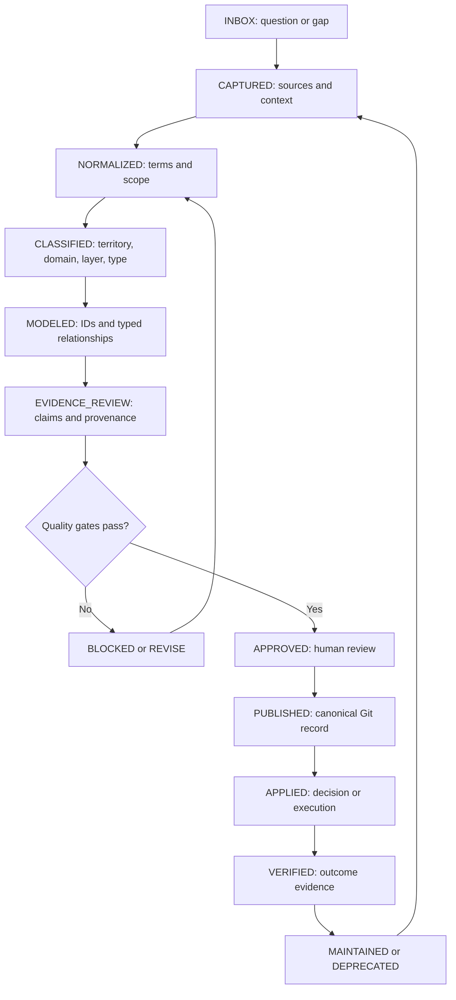

# EKTA Knowledge Operating Workflow

**Status:** Approved operating proposal for the v0.2 repository workflow  
**Applies to:** taxonomy, concepts, techniques, architectures, standards, sources, tools, research, decisions, tests, and playbooks

## 1. Operating principles

EKTA has one canonical source of truth: version-controlled Markdown and YAML in this repository. Runtime indexes, graph exports, search facets, browser pages, and API payloads are derived views. They must be reproducible and must never silently modify canonical records.

The workflow separates two kinds of status:

- **Workflow state** describes where a work item is in the intake/review process.
- **Record status** describes the maturity/evidence state of the published knowledge record (DRAFT, PROPOSED, RESEARCHED, VERIFIED, IMPLEMENTED, VALIDATED, NOT_RUN, BLOCKED, DEPRECATED).

A merge does not automatically promote a record to VERIFIED or VALIDATED. Those labels require evidence specific to the claim or implementation.

## 2. End-to-end lifecycle



| Workflow state | Required inputs | Required output | Exit gate |
|---|---|---|---|
| INBOX | Question, gap, or contribution | Work item with owner and scope | Problem is understandable |
| CAPTURED | URLs, repositories, standards, papers, observations | Source records and access dates | Provenance is recorded |
| NORMALIZED | Candidate terms and excerpts | Canonical term, aliases, exclusions | Ambiguity is documented |
| CLASSIFIED | Canonical record | Territory/domain/layer/type tags | Every identifier exists in a registry |
| MODELED | Candidate relations | Typed edges with stable targets | Predicate and target are valid or explicitly unresolved |
| EVIDENCE_REVIEW | Claims, sources, limitations | Claim-to-evidence review | Evidence strength supports wording/status |
| APPROVED | Complete draft and quality report | Human review decision | Maintainer/reviewer approval recorded |
| PUBLISHED | Approved record | Versioned canonical file | CI passes on merge candidate |
| APPLIED | Published knowledge | Decision, design, or playbook run | Context and assumptions captured |
| VERIFIED | Acceptance criteria and test artifacts | PASS/FAIL/NOT_RUN/BLOCKED result | Evidence is inspectable |
| MAINTAINED | New sources or implementation changes | Revision, supersession, or deprecation | Change rationale recorded |

## 3. Record and taxonomy contracts

Each concept record must have a stable ID, canonical name, revision, status, creation/update dates, and independent classification axes. The current concept JSON Schema is `schemas/concept.schema.json`.

Classification uses:
- **Territory:** one or more of the 26 approved top-level navigation territories in `taxonomy/territories.yml`.
- **Domain:** one or more of the operational domain IDs in `taxonomy/domains.yml`.
- **Layer:** one or more engineering stack layers in `taxonomy/layers.yml`.
- **Knowledge type:** controlled values in `taxonomy/knowledge-types.yml`.

Territories are the portfolio/navigation layer; operational domains are more granular subject tags. Domain-to-territory membership is explicit in `territories.yml`. Do not create a second free-form domain list in a document or interface.

Relationships use controlled predicates in `taxonomy/relations.yml`. A relation has a source, predicate, target, context, provenance, and review state. Unresolved references must remain visible as quality findings; they must not be dropped or guessed.

## 4. Source and evidence handling

For each material external source, capture where possible:
- title, author/publisher, canonical URL, source type;
- publication/update date and access date;
- version, branch, tag, or commit for mutable technical sources;
- license/reuse constraints;
- relevance, limitations, and the specific claims supported.

Prefer primary specifications, official documentation, standards bodies, and original research. Source reputation alone is not proof that a specific claim is supported. Avoid copying protected standards or third-party code into EKTA without rights review.

## 5. Git workflow

1. Create or select a work item. State the question, expected artifact, scope, exclusions, and acceptance criteria.
2. Create a focused branch such as `knowledge/runtime-lifecycle`, `taxonomy/add-testing-territory`, or `feature/search-facets`.
3. Add/update canonical records with the repository templates. Never recycle stable IDs.
4. Link concepts by stable IDs where possible. Do not rely solely on display labels.
5. Run locally from the repository root:

   ```bash
   python -m pip install -e ".[dev]"
   python tools/validate_docs.py
   python -m unittest discover -s tests -v
   python tools/build_graph.py
   ```

6. Open a pull request using `.github/PULL_REQUEST_TEMPLATE.md`. Include source evidence, changed IDs, taxonomy impact, unresolved references, and test results.
7. Review content and code separately: factual/evidence review is not replaced by passing software tests.
8. Merge only when CI passes and the review gates are met. Re-check generated outputs and source revision after changes.
9. Update changelog and implementation plan when the change materially changes capabilities or project status.

## 6. Review gates and decision rights

- **Author:** provenance, completeness, correct IDs, honest uncertainty, and local test execution.
- **Technical/content reviewer:** taxonomy fit, definitions, relationship semantics, evidence quality, and downstream effects.
- **Maintainer:** scope, taxonomy changes, governance, release status, and architecture decisions.

A territory registry change requires maintainer review. A domain/layer/type change requires registry and validator updates in the same change. A new relation predicate requires definition, intended directionality, examples, and tests before use.

## 7. Verification and reporting

Use TEIR: Test → Evaluate → Identify Deviation → Correct → Retest → Re-evaluate.

Allowed test outcomes: PASS, FAIL, NOT_RUN, BLOCKED. Never state that a browser flow, device, deployment, or offline mode passed unless it was exercised and evidence is recorded. Record test environment, command, commit SHA, result, and artifact/log URL.

## 8. Search and discovery contract

The runtime search surface is the discovery entry point, not the canonical record editor. It searches concept records and indexed repository documents. Supported syntax includes:
- free text: `workflow engine`
- hashtag: `#runtime`
- exact phrase: `"workflow runtime"`
- field filter: `territory:software-engineering`, `domain:software-engineering`, `layer:platform-runtime`, `type:concept`, `status:PROPOSED`, `kind:document`, `id:EKTA-CON-000001`

Every result must retain its stable ID and source path. Full content is retrieved through a scoped ID endpoint; the API does not allow arbitrary filesystem paths.

## 9. Continuity and maintenance

Before starting a future work session, read the project README, this workflow, the implementation plan, active ADRs, and the latest CI result. Update `docs/CONTEXT_CONTINUITY.md` when a major decision, blocker, or handoff changes. The canonical repo state takes precedence over stale summaries.
