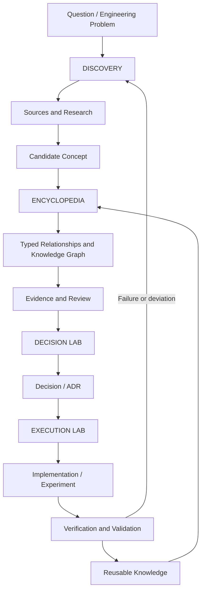
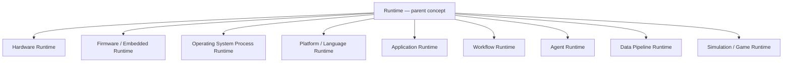
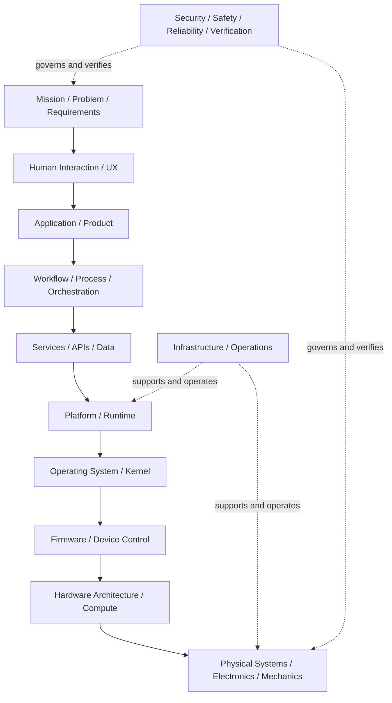
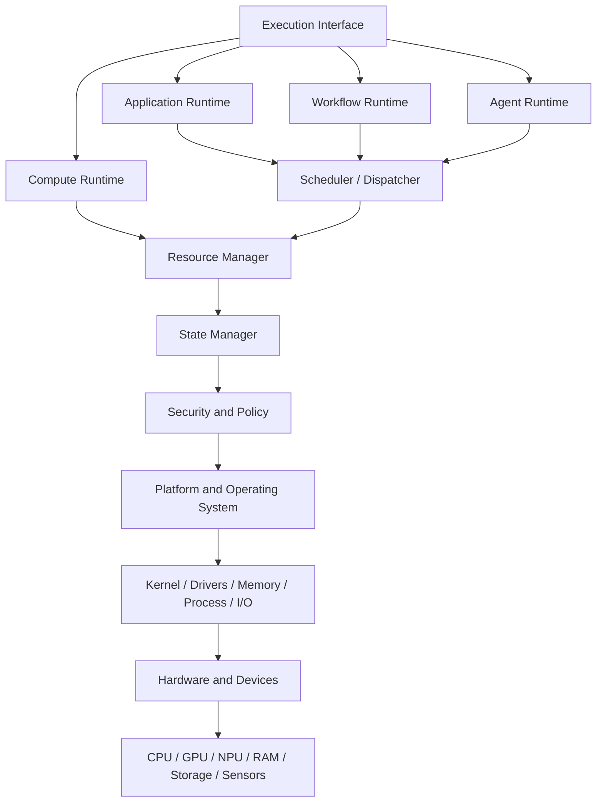

# EKTA — Master Project Handoff
## Engineering Knowledge & Techniques Atlas

**Document ID:** EKTA-HO-0001  
**Document status:** APPROVED PROJECT BASELINE / IMPLEMENTATION HANDOFF  
**Baseline date:** 2026-11-23  
**Canonical repository:** https://github.com/metsam-mastem/EKTA  
**Default branch:** `main`  
**Primary source reviewed:** `EKTA PROJECT.pdf` (114 pages; source material supplied in the conversation)  
**Audience:** project owner, researchers, information architects, software and hardware engineers, contributors, and future AI / automation agents.

---

## 0. Executive handoff

EKTA is an independent engineering knowledge system. Its purpose is not to collect definitions in a static glossary. It is to create a navigable, evidence-backed, multi-layer model of engineering knowledge that connects:

**Knowledge → Architecture → Implementation → Evidence → Decision → Execution → Verification**

A user should be able to begin with a term such as `Runtime`, discover its distinct meanings across hardware, firmware, operating systems, platforms, applications, workflows, agents, and pipelines, inspect related concepts and implementations, compare alternatives, and turn the result into a defensible engineering decision or an executable practice.

EKTA is therefore designed as an **Engineering Knowledge Operating Environment**: a combination of an engineering atlas, concept encyclopedia, typed knowledge graph, research library, decision workspace, and engineering practice library.

The project is independent. Prior work and external projects may be studied as evidence or inspiration, but their repositories, governance, and product streams must not be merged into EKTA without explicit authorization.

### What this handoff establishes

1. Product identity, mission, scope, and operating model.
2. The four product workspaces and end-to-end knowledge lifecycle.
3. A three-axis taxonomy and an initial 26-territory engineering map.
4. A universal engineering layer model and cross-layer concept mapping method.
5. The canonical concept record, relationship graph, evidence model, and status vocabulary.
6. The three knowledge collections: taxonomy, encyclopedia, and practice library.
7. The intended repository and application architecture.
8. A staged product roadmap, acceptance criteria, governance, and next implementation sequence.
9. A source and research strategy grounded in standards, technical documentation, academic work, and open-source implementations.

This is a project handoff and design baseline. It does **not** claim that every concept, graph edge, interface, search engine, offline client, or application feature described here has already been implemented.

---

## 1. Identity, mission, and product thesis

### 1.1 Name

**Engineering Knowledge & Techniques Atlas — EKTA**

### 1.2 Mission

Build a structured, versioned, traceable, searchable, and actionable atlas of engineering knowledge across software, hardware, systems, computing, electronics, manufacturing, automation, robotics, operations, and relevant interdisciplinary fields.

### 1.3 Product thesis

Engineering knowledge is fragmented across books, standards, papers, source repositories, vendor documentation, diagrams, tutorials, and individual experience. The same word may describe different responsibilities in different layers; different words may describe related responsibilities; and an abstract design concept may be confused with one particular implementation.

EKTA addresses this by giving each concept a stable identity, a precise context, a set of typed relationships, evidence, implementation references, trade-offs, and verification methods.

EKTA must answer more than “What does this term mean?” It must help answer:

- What is it, and what is it not?
- Why does it exist?
- How does it work?
- In which engineering domain and layer does it operate?
- What components, interfaces, inputs, and outputs does it have?
- Which concepts does it depend on, implement, control, extend, or compete with?
- Which patterns, techniques, standards, and implementations are relevant?
- What are the operational limits, risks, and trade-offs?
- How can a claim or implementation be tested and verified?
- What decision or practical action can be derived from this knowledge?

### 1.4 Product boundaries

EKTA covers three connected but distinguishable engineering macro-domains:

- **Software Engineering:** software, algorithms, data, operating systems, platforms, applications, AI, and software operations.
- **Hardware Engineering:** electronics, semiconductors, processors, boards, firmware, mechanical systems, materials, and manufacturing.
- **Systems Engineering:** system-of-systems thinking, interfaces, integration, lifecycle, requirements, verification, safety, reliability, and coordination across disciplines.

Process engineering, human factors, project and product engineering, governance, and decision methods are represented where they contribute to engineering work. They are not treated as unrelated appendices.

---

## 2. Product operating model — four workspaces

The four workspaces are the primary user-facing product architecture. They are connected stages, not four unrelated products.

### ZONE 01 — DISCOVERY
**Purpose:** Find, inspect, compare, qualify, and extract knowledge.

Inputs:
- Questions and engineering problems
- Technical terms and candidate concepts
- Standards, papers, books, and technical documentation
- GitHub / GitLab repositories and source code
- Diagrams, models, datasets, and implementation examples
- Existing systems and reverse-engineering observations

Outputs:
- Research records
- Candidate concepts
- Source and evidence records
- Initial classifications
- Unresolved questions and research tasks

### ZONE 02 — ENCYCLOPEDIA
**Purpose:** Maintain canonical, structured engineering knowledge.

Contents:
- Concept and terminology records
- Domain, layer, and knowledge-type taxonomies
- Architecture and mechanism descriptions
- Component and interface models
- Typed concept relationships
- Cross-layer concept maps
- Standards and implementation references

Outputs:
- Canonical concept records
- Reviewed definitions
- Knowledge maps and graph data
- Versioned terminology and classification

### ZONE 03 — DECISION LAB
**Purpose:** Compare options and make traceable engineering decisions.

Capabilities:
- Architecture comparison
- Alternative and implementation comparison
- Feasibility analysis
- Cost, performance, energy, reliability, security, and maintainability trade-offs
- Risk assessment
- Weighted scoring and decision matrices
- ADR creation and decision provenance

Outputs:
- Decision records
- Architecture Decision Records (ADRs)
- Comparison matrices
- Explicit assumptions, constraints, and unresolved risks

### ZONE 04 — EXECUTION LAB
**Purpose:** Turn knowledge and decisions into repeatable engineering practice.

Capabilities:
- Design and implementation playbooks
- Step-by-step procedures
- Prototype and experiment plans
- Build, test, and deployment instructions
- Verification and validation plans
- Checklists and acceptance criteria
- Evidence capture and post-execution review

Outputs:
- Playbooks
- Test plans and results
- Implementation records
- Reusable engineering procedures
- Lessons learned and updated knowledge

### 2.1 End-to-end knowledge lifecycle



A rejected hypothesis, failed test, or new implementation is not discarded. It returns to discovery or updates the relevant concept with provenance and a new revision.

---

## 3. Taxonomy architecture — three independent axes

The taxonomy must never collapse three different questions into one tree.

### Axis A — Engineering Domain
**Question:** What engineering territory is involved?

Examples: software, systems, electronics, computer architecture, mechanical engineering, robotics, operations, product engineering.

### Axis B — Engineering Layer
**Question:** At which level of abstraction or system boundary does the concept operate?

Examples: physical, logical, execution, platform, application, workflow, organizational, and lifecycle layers.

### Axis C — Knowledge / Technique Type
**Question:** What kind of knowledge item is this?

Examples: concept, principle, architecture, component, mechanism, algorithm, protocol, method, technique, pattern, standard, tool, interface, process, metric, failure mode, evidence, decision, and playbook.

A concept may be associated with multiple domains, layers, and types. The taxonomy is multidimensional; it is not a requirement to duplicate the concept into multiple folders.

### 3.1 Initial engineering layer model

The following is a reference model, not a claim that every system contains every layer:

1. Mission, problem, and system context
2. Human, stakeholder, and interaction
3. Product and application
4. Workflow, process, and orchestration
5. Service, API, and data
6. Platform and runtime
7. Operating system and kernel
8. Firmware, device control, and embedded execution
9. Hardware architecture and computation
10. Physical implementation, electronics, mechanics, and materials
11. Infrastructure, operations, and lifecycle — cross-cutting
12. Security, safety, reliability, and verification — cross-cutting

Layer membership must be justified by a concept's role, not inferred from its name.

---

## 4. Master engineering territory map

The source material begins with a 21-territory discovery map and then expands into further families. For a usable master atlas, this handoff consolidates the complete scope into **26 top-level territories**. The numbering is for navigation, not a ranking.

### Foundation and computing

1. **Engineering Sciences and Mathematics** — algebra, linear algebra, calculus, discrete mathematics, probability, statistics, logic, numerical methods, optimization, information theory, graph theory, physics, signals, and dynamical systems.
2. **Systems Engineering** — systems thinking, systems architecture, requirements, stakeholder analysis, MBSE, functional decomposition, integration, interface management, lifecycle, risk, trade-off, verification, validation, and systems-of-systems.
3. **Software Engineering** — requirements, architecture, design, programming, patterns, application engineering, build, release, deployment, maintenance, and software operations.
4. **Computer Science** — algorithms, data structures, computation theory, complexity, type systems, parallel and distributed algorithms, cryptography, graphics, HCI, and data science foundations.
5. **Operating Systems and Platform Engineering** — kernels, processes, threads, scheduling, synchronization, memory, filesystems, I/O, device models, platform services, and runtime environments.
6. **Data and Database Engineering** — data modeling, relational and non-relational databases, graph and vector stores, storage and query engines, transactions, indexing, pipelines, streaming, lineage, and governance.
7. **Networking and Telecommunications** — network architecture, protocols, network equipment, RF, antennas, modulation, MIMO, beamforming, spectrum, link budgets, and software-defined radio.
8. **Distributed Systems and Cloud / Infrastructure Computing** — clusters, edge, fog, cloud, containers, virtualization, orchestration, coordination, consensus, replication, consistency, service mesh, and fault tolerance.
9. **Artificial Intelligence, Machine Learning, and Agents** — AI foundations, model architecture, training, fine-tuning, quantization, inference, model serving, agent runtime, orchestration, tool use, RAG, context, memory, evaluation, and guardrails.

### Hardware and physical engineering

10. **Electronics and Semiconductor Engineering** — semiconductor physics, fabrication, analog, digital, mixed-signal, power, RF, microwave, high-speed, sensors, components, and circuit analysis.
11. **Computer Architecture and Processor Engineering** — ISA, microarchitecture, CPU/GPU/NPU/DSP/MCU/FPGA/ASIC, pipelines, execution units, memory hierarchy, cache coherence, buses, interconnects, and accelerators.
12. **Chip Design Engineering** — logic design, RTL, HDL, verification, synthesis, floorplanning, placement, clock-tree synthesis, routing, timing, physical verification, tape-out, and post-silicon validation.
13. **PCB and Electronic System Engineering** — schematics, component selection, footprints, placement, routing, multilayer boards, signal and power integrity, thermal design, power supplies, DFM/DFA/DFT, and board testing.
14. **Firmware and Embedded Systems** — boot ROM, bootloaders, BIOS/UEFI, BSP, HAL, drivers, interrupts, bare-metal, RTOS, embedded Linux, real-time scheduling, sensors, actuators, and secure updates.
15. **Mechanical, Materials, and Manufacturing Engineering** — mechanical design, statics, dynamics, materials science, metallurgy, polymers, composites, machining, CNC, additive manufacturing, CAD/CAM/CAE, FEA/CFD, digital twins, and production.
16. **Robotics, Control, and Mechatronics** — control systems, feedback, PID, state-space, sensors, actuators, motion planning, SLAM, localization, machine vision, robot operating systems, and industrial automation.

### Cross-cutting and operational engineering

17. **Security, Safety, and Resilience Engineering** — secure design, threat modeling, cryptography, identity, access control, hardware security, functional safety, hazard analysis, fault tolerance, recovery, and supply-chain security.
18. **Testing, Verification, Validation, and Quality Engineering** — unit through system testing, acceptance, regression, stress, fuzz, mutation, property-based, formal verification, HIL/SIL/PIL, inspection, certification, and quality assurance.
19. **Workflow and Process Engineering** — workflow definitions and instances, engines, runtimes, orchestration, DAGs, dependencies, retries, compensation, checkpoints, durable execution, state persistence, and recovery.
20. **Automation Engineering** — software, business process, RPA, IT, infrastructure, network, test, manufacturing, laboratory, data, and AI automation; triggers, rules, connectors, executors, workers, queues, approvals, and monitoring.
21. **UX, UI, and Human–Computer / Machine Interaction** — information architecture, interaction design, design systems, multimodal interfaces, accessibility, cognitive ergonomics, user flows, usability, and experience evaluation.
22. **Operations and Reliability Engineering** — IT operations, SRE, incident and change management, observability, telemetry, metrics/logs/traces, SLI/SLO/SLA, error budgets, availability, maintainability, and disaster recovery.
23. **Product Engineering** — discovery, product definition, requirements, architecture, roadmaps, lifecycle, MVP, prototyping, product validation, product analytics, iteration, and retirement.
24. **Project Engineering and Development Process Management** — planning, WBS, critical path, Agile, Scrum, Kanban, Scrumban, Lean, V-model, iterative and incremental delivery, risk, resources, change, and decision management.
25. **Engineering Documentation, Standards, and Governance** — technical documentation, specifications, ADRs, interface control documents, data dictionaries, SOPs, configuration baselines, traceability, compliance, audit trails, evidence, and decision provenance.
26. **Applied and Interdisciplinary Engineering Domains** — automotive, aerospace, medical, energy, industrial, agriculture, construction, transportation, marine, environment, biotechnology, media/cinema, games, physical security, logistics, meteorology, and financial systems.

The map is deliberately broad. Each territory must be decomposed into subdomains, concept families, and individually reviewed records. A list of terms is not yet an encyclopedia.

---

## 5. Cross-layer concept mapping

This is a defining EKTA capability. A shared label does not guarantee an identical meaning, responsibility, implementation, or lifecycle.

### 5.1 Example: Runtime



Examples:
- Hardware: CUDA Runtime and GPU execution support.
- Firmware: embedded runtime or RTOS execution environment.
- Operating system: process and thread execution facilities.
- Platform: JVM, .NET Runtime, Android Runtime (ART), Node.js, Python.
- Application: application lifecycle and state execution.
- Workflow: Temporal, Apache Airflow, Camunda, and related workflow engines.
- Agent: agent lifecycle, planning, tool execution, memory, and control.
- Pipeline: execution of data or build stages.
- Simulation / game: simulation or game-loop execution environment.

These are members of a related concept family, not interchangeable products or equivalent implementations.

### 5.2 Build, load, and runtime

- **Design Time:** architecture, data, and behavior are designed.
- **Development Time:** code and other artifacts are authored.
- **Build Time:** source is compiled, bundled, packaged, or transformed into artifacts.
- **Load Time:** code and dependencies are loaded and prepared.
- **Runtime:** the program or operation is executing.
- **Monitoring / Operations:** behavior, health, failures, and resource use are observed.

This is a conceptual lifecycle. Real systems may overlap, repeat, or distribute these phases.

### 5.3 Related concept families

EKTA should examine these terms across relevant layers: Engine, Scheduler, Controller, Manager, Executor, Worker, Driver, Adapter, Interface, Bus, Broker, Gateway, Queue, Cache, State Machine, Pipeline, Monitor, Supervisor, Registry, Compiler, Interpreter, Loader, and Orchestrator.

The record must distinguish a shared architectural role from a context-specific implementation.

---

## 6. Concept model and canonical engineering record

Every concept receives a stable ID. One concept may have multiple context-specific realizations or senses; do not force them into a single oversimplified definition.

### 6.1 Required concept dimensions

1. **Identity:** canonical name, stable ID, aliases, Persian equivalents, version, and status.
2. **Definition:** concise definition, scope, exclusions, and disambiguation.
3. **Classification:** domain(s), layer(s), knowledge type(s), family, and parent concepts.
4. **Purpose:** problem addressed, rationale, and intended outcome.
5. **Role:** responsibility within a system and boundary of ownership.
6. **Architecture:** context, components, interfaces, and deployment position.
7. **Mechanism:** internal behavior, lifecycle, states, transitions, and execution sequence.
8. **Inputs / outputs:** data, commands, events, resources, results, and errors.
9. **Dependencies:** prerequisites, collaborators, constraints, and external services.
10. **Relationships:** typed links to related concepts.
11. **Patterns and techniques:** design approaches and operational methods.
12. **Implementations:** projects, products, libraries, source repositories, and versions.
13. **Properties:** performance, reliability, availability, isolation, concurrency, energy, security, and maintainability as relevant.
14. **Trade-offs:** complexity, latency, memory, power, cost, portability, failure behavior, and operational burden.
15. **Verification:** tests, measurements, formal methods, benchmarks, inspection, and reproducibility.
16. **Evidence:** sources, claims, provenance, confidence, review date, and license/reuse conditions.

### 6.2 Example: Runtime concept card

**Canonical concept:** Runtime  
**Related definition:** Execution environment / execution mechanism

| Dimension | Engineering question | Example content |
|---|---|---|
| What | What is it? | Environment or mechanism that enables and manages execution |
| Why | Why does it exist? | Turns code, instructions, tasks, or workflow definitions into operations |
| How | How does it work? | Loading, preparation, resource allocation, execution, state management, error handling |
| Where | Where does it operate? | Hardware, firmware, OS, platform, application, workflow, agent |
| Components | What is it made of? | Loader, executor, scheduler, memory manager, state manager (context-dependent) |
| I/O | What enters and leaves? | Code, commands, tasks, data; results, state changes, errors |
| Relations | What is it connected to? | Engine, scheduler, orchestrator, process, worker, resource manager |
| Properties | What matters? | Performance, reliability, isolation, concurrency, resource efficiency |
| Techniques | How is it implemented? | Event loop, thread pool, task scheduling, checkpointing, sandboxing |
| Implementations | Where can it be studied? | JVM, ART, Node.js, Temporal, CUDA Runtime |
| Trade-offs | What can be costly? | Memory, latency, complexity, recovery, platform dependency |
| Verification | How can it be assessed? | Benchmark, stress test, recovery test, resource profiling |

The table is a model for the record, not a claim that all runtimes contain the same components.

---

## 7. Knowledge graph and relationship semantics

EKTA's graph must contain both nodes and typed edges. A node-only export is an index, not a complete knowledge graph.

### 7.1 Initial relationship vocabulary

- `IS-A` — specialization or subtype
- `PART-OF` — structural membership
- `USES` — usage dependency
- `DEPENDS-ON` — prerequisite or runtime dependency
- `IMPLEMENTS` — realization of an abstraction or contract
- `EXTENDS` — compatible extension
- `CONTROLS` — control responsibility
- `EXECUTES` — execution responsibility
- `SCHEDULES` — scheduling responsibility
- `OBSERVES` — monitoring or observation
- `COMPETES-WITH` — alternative solutions to a comparable need
- `RELATED-TO` — broad relation, used only when a more precise type is not justified

### 7.2 Edge record

Each edge should include:
- Stable edge ID
- Source concept ID
- Relationship type
- Target concept ID
- Context / layer where the relation holds
- Directionality
- Source and evidence
- Confidence / review status
- Validity or revision metadata where relevant

### 7.3 Graph validation rules

- Source and target nodes must exist.
- Relationship types must come from a controlled vocabulary.
- Self-links must be explicitly permitted or rejected by relation type.
- Evidence must be recorded for claims that are not obvious structural facts.
- Cross-layer relations must name the context in which they hold.
- Competing implementations must not be represented as equivalent without evidence.
- Deprecated concepts and edges remain traceable rather than silently disappearing.

---

## 8. Three knowledge collections

Keep the following collections logically distinct, while connecting them through IDs and graph relations.

### 8.1 Master Taxonomy

Contains the complete domain map, subdomains, layers, knowledge types, families, and controlled vocabularies.

### 8.2 Concept Encyclopedia

Contains canonical concept records: definitions, mechanisms, roles, architecture, implementations, trade-offs, and relationships.

### 8.3 Engineering Practice Library

Contains techniques, methods, patterns, standards, tools, experiments, playbooks, checklists, test procedures, and reproducible examples.

A standard, tool, paper, or repository is not itself automatically a concept definition. It is a source, implementation, or practice artifact connected to relevant concepts.

---

## 9. Engineering model and visualization system

EKTA is not limited to one modeling language. Select a representation based on the question and the artifact being modeled.

| Representation | Best use |
|---|---|
| Taxonomy / tree | Domain decomposition and navigation |
| Ontology | Formal concept definitions and semantic constraints |
| Knowledge graph | Typed relations and cross-domain discovery |
| UML | Software structure and behavior |
| SysML | System architecture and engineering models |
| BPMN | Business and operational processes |
| ERD | Data entities and relationships |
| DFD | Data movement and transformations |
| C4 Model | Software system context and component boundaries |
| State machine | States, events, and transitions |
| Sequence diagram | Time-ordered interactions |
| Activity diagram | Activities and control flow |
| Block diagram | System decomposition and interfaces |
| Schematic | Electronic circuits |
| Timing diagram | Signals, timing, and digital behavior |
| CAD / FEA / CFD | Physical geometry and engineering analysis |
| Digital twin | Connected digital representation of a physical system |

### 9.1 Visualization principles

- Keep the canonical model machine-readable where possible.
- Generate diagrams from structured data when feasible.
- Keep diagrams linked to the concepts and evidence they represent.
- Distinguish conceptual diagrams from measured or implementation-accurate diagrams.
- Preserve source, revision, and assumptions for each visualization.
- Provide both a visual representation and a textual explanation for accessibility and search.

---

## 10. Universal engineering stack

The stack is a reference map for locating responsibilities. It is not a mandatory architecture for every project.



The vertical chain is a conceptual path. Infrastructure and quality attributes cut across multiple layers rather than belonging to one fixed point.

### 10.1 Universal execution architecture — reference pattern



This is a reference architecture for analysis, not a prescribed design. Some systems combine responsibilities in one engine or service; separate runtimes are not automatically better.

Architecture questions to resolve:
- What execution request is accepted?
- Which runtime owns each lifecycle?
- Which scheduler makes which scheduling decision?
- Which resources are allocated, reserved, or shared?
- Where is state persisted?
- How are cancellation, timeout, retry, compensation, and recovery handled?
- How do runtimes interact with the OS, firmware, and hardware?
- Where are policy enforcement, security, monitoring, testing, and verification performed?

---

## 11. Research, evidence, and open-source strategy

EKTA should combine normative standards, authoritative technical documentation, academic research, and inspectable implementations.

### 11.1 Source classes

1. Standards and specifications
2. Official handbooks and reference documentation
3. Peer-reviewed research and systematic reviews
4. Maintainer-owned source repositories
5. Technical design documents and architecture records
6. Reproducible experiments, benchmarks, and test results
7. Carefully qualified practitioner material

### 11.2 Initial reference sources

- [IEEE SWEBOK](https://www.computer.org/education/bodies-of-knowledge/software-engineering/topics) — software engineering body of knowledge.
- [SEBoK](https://sebokwiki.org/wiki/SEBoK_Introduction) — systems engineering body of knowledge.
- [NASA Systems Engineering Handbook](https://www.nasa.gov/reference/systems-engineering-handbook/) — lifecycle, design, verification, and validation.
- [Linux Kernel Documentation](https://www.kernel.org/doc/html/latest/) — operating-system and kernel mechanisms.
- [RISC-V Specifications](https://docs.riscv.org/) — processor instruction-set architecture and extensions.
- [NIST Secure Software Development Framework (SSDF)](https://csrc.nist.gov/pubs/sp/800/218/final) — secure software development practices.
- [Nature Index: Ontology Engineering and Semantic Knowledge Systems](https://www.nature.com/nature-index/topics/l4/ontology-engineering-and-semantic-knowledge-systems) — research landscape for ontology and semantic knowledge systems.
- [GitLab Orbit architecture](https://handbook.gitlab.com/handbook/engineering/architecture/design-documents/orbit/) — an engineering example of representing repository information as a graph.
- [Engineering Knowledge Framework](https://github.com/dhruvasagar/engineering-knowledge-framework) — an open-source reference to inspect for engineering knowledge organization.
- [Digital Thread literature review (Systems, 2024)](https://www.mdpi.com/2079-8954/12/3/70) — engineering information continuity and digital-thread concepts.
- [Ontology of Systems Engineering](https://www.sciencedirect.com/science/article/pii/S1877050919307380) — ontology-oriented systems engineering research.
- [Model management for systems engineering workflows using ontology-based knowledge graphs (2024)](https://www.sciencedirect.com/science/article/pii/S2452414X24001638) — model and workflow management research.
- [Digital thread in engineering (2025)](https://www.sciencedirect.com/science/article/pii/S147403462500151X) — digital-thread research.

These are starting references, not blanket endorsements. Each source must be reviewed for authority, date, scope, version, and applicability before a claim is marked verified.

### 11.3 Open-source reuse policy

For every external repository or artifact:
- Record canonical URL, owner, version or commit, and access date.
- Inspect license and attribution obligations.
- Distinguish source code, documentation, data, and generated assets.
- Do not copy code or diagrams merely because they are publicly visible.
- Prefer linking to the original and documenting what was learned.
- Record local adaptations and their provenance.
- Never infer that public visibility means permission to redistribute.

**EKTA's own repository license remains undecided.** Do not describe EKTA as an openly licensed project until a license decision is made and the license file is committed.

---

## 12. Product and platform architecture

The knowledge model is the core product. User interfaces and automation are clients of that model, not competing sources of truth.

### 12.1 Proposed logical architecture

```text
                 ┌─────────────────────────────┐
                 │      User Interfaces        │
                 │ Web / Desktop / Android     │
                 │ CLI / API / AI Interface    │
                 └──────────────┬──────────────┘
                                │
                 ┌──────────────▼──────────────┐
                 │       Application Layer     │
                 │ Search / Explore / Compare  │
                 │ Review / Decision / Execute │
                 └──────────────┬──────────────┘
                                │
          ┌─────────────────────▼────────────────────┐
          │          Knowledge Services              │
          │ Taxonomy / Concepts / Graph / Evidence    │
          │ Search / Provenance / Versioning         │
          └─────────────────────┬────────────────────┘
                                │
          ┌─────────────────────▼────────────────────┐
          │          Canonical Knowledge Store       │
          │ Git-native files + structured metadata   │
          │ Generated indexes and graph projections  │
          └─────────────────────┬────────────────────┘
                                │
          ┌─────────────────────▼────────────────────┐
          │      Validation / Build / CI Pipeline    │
          │ Schema / Links / IDs / Relations / Tests │
          └──────────────────────────────────────────┘
```

### 12.2 Staged platform evolution

**Stage A — Git-native foundation**
- Markdown and structured metadata
- Stable IDs and controlled vocabularies
- Templates, schemas, and deterministic validators
- Git history as the reviewable change record

**Stage B — Static web knowledge portal**
- Browse domains, layers, and concept families
- Search and filter
- Stable URLs for concept records
- Render diagrams and source references

**Stage C — Local-first atlas**
- Offline snapshot
- Local search and graph navigation
- Import/export and portable data
- No mandatory dependency on a single cloud provider

**Stage D — Interactive engineering workbench**
- Compare alternatives
- Create and review decisions
- Generate playbooks and test plans
- Attach execution evidence

**Stage E — AI-assisted knowledge interface**
- Retrieval grounded in canonical records
- Citations to source claims
- Context packs for project handoff
- Human review and approval gates
- Explicit separation between sourced facts, inference, and proposals

This is the proposed sequence. It is not a statement that stages B–E are already built.

### 12.3 Platform principles

- Git-native and portable source of truth.
- Local-first capability where it materially improves availability and user control.
- Modular architecture and replaceable providers.
- No unnecessary dependence on one vendor or cloud.
- Search and graph projections are rebuildable from canonical data.
- AI outputs remain reviewable and source-linked.
- Human approval is required for consequential changes to canonical knowledge or project governance.

---

## 13. Repository architecture

The repository is the canonical, reviewable knowledge source. The structure below is the intended logical organization; the current Git tree is authoritative for which files actually exist.

```text
EKTA/
├── README.md
├── PROJECT_CHARTER.md
├── CONTRIBUTING.md
├── GOVERNANCE.md
├── LICENSE-STATUS.md
├── docs/
│   ├── MASTER_HANDOFF.md
│   ├── PROJECT_GUIDE.md
│   ├── REPOSITORY_MAP.md
│   ├── GOVERNANCE.md
│   ├── ARCHITECTURE.md
│   ├── KNOWLEDGE_ARCHITECTURE.md
│   ├── CONTEXT_CONTINUITY.md
│   ├── LIFECYCLE.md
│   ├── QUALITY_GATES.md
│   ├── ROADMAP.md
│   ├── GLOSSARY.md
│   └── VISION_AND_PRODUCT_STORY.md
├── taxonomy/
│   ├── MASTER_TAXONOMY.md
│   ├── DOMAINS.md
│   ├── LAYERS.md
│   ├── KNOWLEDGE_TYPES.md
│   └── RELATION_TYPES.md
├── encyclopedia/
│   ├── concepts/
│   ├── techniques/
│   ├── methods/
│   ├── patterns/
│   ├── standards/
│   └── implementations/
├── maps/
│   ├── ENGINEERING_ATLAS.md
│   ├── UNIVERSAL_ENGINEERING_STACK.md
│   ├── CROSS_LAYER_CONCEPTS.md
│   └── KNOWLEDGE_GRAPH.md
├── schemas/
│   ├── concept.schema.json
│   ├── relationship.schema.json
│   ├── source.schema.json
│   ├── decision.schema.json
│   └── status.schema.json
├── research/
│   ├── source-reviews/
│   ├── literature/
│   ├── repository-audits/
│   └── experiments/
├── references/
│   ├── standards/
│   ├── open-source-projects/
│   └── bibliography/
├── templates/
│   ├── CONCEPT_TEMPLATE.md
│   ├── TECHNIQUE_TEMPLATE.md
│   ├── RESEARCH_TEMPLATE.md
│   ├── ADR_TEMPLATE.md
│   └── PLAYBOOK_TEMPLATE.md
├── tools/
│   ├── validate_docs.py
│   ├── build_graph.py
│   └── build_search_index.py
├── tests/
└── .github/
    └── workflows/
        └── validate.yml
```

Do not create empty folders solely to make the tree look complete. Add each area when its schema, purpose, owner, and validation path are clear. Preserve existing canonical files and IDs when evolving the repository.

### 13.1 Repository roles

- `README.md`: project landing page and current handoff entry.
- `PROJECT_CHARTER.md`: approved mission, scope, boundaries, and governance.
- `docs/`: project architecture, lifecycle, product vision, continuity, and operating instructions.
- `taxonomy/`: controlled classifications and relation vocabulary.
- `encyclopedia/`: reviewed knowledge records.
- `maps/`: navigable visual and structural maps.
- `schemas/`: machine-readable contracts.
- `research/`: investigations and source assessments.
- `references/`: curated external standards, projects, and bibliography.
- `templates/`: repeatable authoring structures.
- `tools/` and `tests/`: deterministic generation, validation, and automated checks.
- `.github/workflows/`: repository quality gates.

---

## 14. Governance, evidence, and status semantics

### 14.1 Project independence

EKTA is an independent project. Do not merge its repositories, documents, roadmaps, or project identities with other workstreams without explicit user direction. External work can be cited, adapted where permitted, or used as a design reference while keeping project boundaries intact.

### 14.2 Status vocabulary

Use these statuses consistently:

- `PROPOSED` — suggested, not yet researched or approved.
- `RESEARCHED` — investigated with sources, but not independently verified.
- `VERIFIED` — claim checked against sufficient evidence for its stated scope.
- `IMPLEMENTED` — implementation exists in the repository or named system.
- `VALIDATED` — acceptance criteria and tests passed under recorded conditions.
- `NOT_RUN` — required check has not been executed.
- `BLOCKED` — work cannot proceed; reason and unblock condition must be recorded.
- `DEPRECATED` — superseded or no longer recommended; retain traceability.

Approval of the charter does not mean every design proposal is implemented or validated.

### 14.3 Evidence hierarchy

Prefer:
1. Normative standards and official specifications.
2. Maintainer-owned technical documentation and source code.
3. Peer-reviewed research with relevant methods and scope.
4. Reproducible tests, measurements, and benchmark data.
5. Reputable technical analysis with transparent evidence.
6. Community discussion as a source of leads, not final authority.

A citation supports only the claim it actually substantiates. A source's existence does not validate every statement in a concept record.

### 14.4 Review requirements

- Technical claims need source references and a review date.
- Implementation claims need repository links and versions or commits.
- Performance claims need workload, environment, method, and measured results.
- Security and safety claims need explicit scope and threat/hazard context.
- Standards claims need exact edition/version and applicability.
- Unverified or disputed statements must be labelled as such.

### 14.5 Change control

Changes to canonical taxonomy, schemas, relation semantics, IDs, governance, and product scope require a reviewable change record. Use an ADR for decisions with material architectural consequences. Preserve old IDs and revision history; do not silently rewrite historical facts.

---

## 15. Quality gates and acceptance criteria

### Gate A — Content integrity
- Every canonical concept has a unique stable ID.
- Required fields conform to the schema.
- Status is explicit and valid.
- Aliases do not create accidental duplicate identities.
- Internal references resolve.

### Gate B — Taxonomy integrity
- Domain, layer, and knowledge type are separate fields.
- Each classification uses a controlled vocabulary.
- Multi-domain and multi-layer membership is supported.
- Parent-child relations are semantically valid.

### Gate C — Graph integrity
- All edge endpoints exist.
- Relation types are valid.
- Direction and context are explicit.
- No unsupported equivalence is inferred.
- Graph generation is deterministic.

### Gate D — Evidence integrity
- Sources are traceable.
- Claim-to-source relationships are inspectable.
- Version, date, and provenance are recorded where applicable.
- License and reuse conditions are reviewed.

### Gate E — Engineering quality
- Validators and tests run in CI.
- Test output and commit are inspectable.
- A passing validator is not misrepresented as proof of content completeness.
- A generated graph is not called complete unless edge extraction and edge validation are implemented.

### Gate F — Product usability
- A user can discover a concept from domain, layer, or term.
- A concept page shows its meaning, context, relations, and evidence.
- A user can move from a concept to a comparison or playbook.
- Search results distinguish aliases, homonyms, and contextual senses.

---

## 16. Roadmap and implementation sequence

The implementation order should reduce structural rework before large-scale content expansion.

### Phase 0 — Governance and source baseline
**Goal:** lock the project identity and the source of truth.

Deliverables:
- Approved charter and vision
- Master handoff
- Repository map
- License decision remains explicitly open
- Context continuity and decision records

Exit criteria:
- Project scope and boundaries are explicit.
- Current repository state is documented.
- No implementation claim is unsupported.

### Phase 1 — Taxonomy and data contracts
**Goal:** establish stable knowledge semantics.

Deliverables:
- Master taxonomy for 26 territories
- Layer taxonomy
- Knowledge-type taxonomy
- Relation vocabulary
- JSON Schemas for concepts, edges, sources, and decisions
- Controlled ID policy

Exit criteria:
- Example records validate.
- Taxonomy fields remain independent.
- Cross-domain and cross-layer membership works.

### Phase 2 — Core encyclopedia
**Goal:** produce high-quality concept records before bulk expansion.

Priority concept families:
- Runtime, Engine, Scheduler, Controller, Manager
- Executor, Worker, Process, Thread, Task
- Orchestrator, Dispatcher, Queue, Broker
- Driver, Adapter, Interface, Gateway
- State Machine, Pipeline, Monitor, Supervisor, Registry

Exit criteria:
- Each record has context, disambiguation, relations, evidence, and verification guidance.
- Duplicate or ambiguous concepts are resolved.
- Content is reviewed, not merely generated.

### Phase 3 — Relationship graph
**Goal:** build a typed, validated graph.

Deliverables:
- Edge schema and relation constraints
- Graph extraction from concept metadata
- Graph integrity tests
- Deterministic JSON export
- Cross-layer maps generated from validated data

Exit criteria:
- Nodes and edges are both represented.
- Every edge has valid endpoints and a known relation type.
- Graph output can be rebuilt from canonical source records.

### Phase 4 — Engineering practice and research library
**Goal:** connect concepts to applied work.

Deliverables:
- Technique, method, pattern, and standard records
- Open-source implementation audits
- Source and license reviews
- Test and experiment playbooks
- Reproducible comparison records

Exit criteria:
- Each implementation is tied to the concept it realizes.
- Reuse obligations are documented.
- Practice records include prerequisites and verification.

### Phase 5 — Searchable web portal
**Goal:** make the atlas usable without editing Markdown.

Deliverables:
- Domain and layer navigation
- Full-text and semantic search as separately labelled capabilities
- Concept pages with relationships and evidence
- Stable deep links
- Responsive and accessible UI

Exit criteria:
- A new user can find, understand, and follow a concept's relations.
- Search results expose provenance and status.

### Phase 6 — Local-first and decision / execution workbench
**Goal:** turn the knowledge base into a practical engineering tool.

Deliverables:
- Offline snapshot and local search
- Decision comparison workspace
- ADR and playbook workflows
- Test/evidence capture
- Import/export and backup

Exit criteria:
- Core knowledge remains usable offline.
- Decisions can be traced to concepts and evidence.
- Execution outcomes can update the knowledge base through review.

### Phase 7 — AI-assisted knowledge interface
**Goal:** accelerate research without weakening evidence quality.

Deliverables:
- Retrieval grounded in canonical records
- Source-linked answers
- Context packages for handoff
- Human review gates
- Explicit provenance for generated suggestions

Exit criteria:
- No unsupported answer is presented as verified knowledge.
- Users can inspect the underlying sources and records.
- Human approval controls canonical changes.

---

## 17. Immediate next actions

The next work should be performed in this order:

1. Audit the current Git tree against the intended repository map; do not assume the target tree already exists.
2. Reconcile the 26-territory master map with existing taxonomy files and assign stable IDs.
3. Finalize the machine-readable concept and relationship schemas.
4. Extend the validator to check schema fields, taxonomy references, duplicate IDs, and relation endpoints.
5. Upgrade graph generation from node-only indexing to typed node-and-edge export.
6. Add reviewed records for the core cross-layer family, beginning with Runtime, Engine, Scheduler, Controller, and Manager.
7. Add bilingual glossary entries for canonical terms and aliases.
8. Add source-review records for the initial standards, research, and open-source references.
9. Run CI and inspect the actual workflow result for the exact commit.
10. Only then expand the encyclopedia in batches with explicit review and quality gates.

Do not generate hundreds of shallow records before the taxonomy, schemas, and validators are stable.

---

## 18. Handoff protocol for future contributors and AI agents

Before changing EKTA:

1. Read this handoff, the approved charter, governance, architecture, and context-continuity documents.
2. Inspect the current branch, Git tree, recent commits, and CI status.
3. Identify whether the task changes taxonomy, content, schemas, graph semantics, product UI, or governance.
4. Check existing IDs and records before creating new ones.
5. Verify external sources and license conditions.
6. Make the smallest coherent change.
7. Run relevant validators and tests.
8. Record changed files, commit SHA, test evidence, limitations, and remaining work.
9. Update context-continuity and roadmap documents when decisions or project state materially change.
10. Never claim that a file, feature, test, deployment, or integration exists unless it is visible and verified.

### Required handoff report format

- **Task / objective**
- **Scope and assumptions**
- **Files changed**
- **Architecture or data-model impact**
- **Sources and evidence**
- **Validation performed**
- **Exact test / CI result**
- **Commit or pull request**
- **Known limitations**
- **Next action**

---

## 19. Approved project decisions and open decisions

### Approved
- Project name: Engineering Knowledge & Techniques Atlas (EKTA).
- Canonical repository: `metsam-mastem/EKTA`.
- Project remains independent.
- The charter and current product vision were explicitly approved on 2026-11-23.
- Four workspaces: DISCOVERY, ENCYCLOPEDIA, DECISION LAB, EXECUTION LAB.
- Three independent taxonomy axes: Engineering Domain, Engineering Layer, Knowledge / Technique Type.
- Evidence-backed, traceable, versioned engineering knowledge is the core product direction.

### Still open / requires separate decision
- Repository license.
- Final application technology stack.
- Hosting and deployment architecture.
- Exact graph database or graph storage choice.
- Search engine and indexing technology.
- Authentication and contribution model for a future hosted portal.
- Final language policy and degree of bilingual coverage.
- UI design system and visual interaction model.

Do not infer approval for these items from charter approval.

---

## 20. Product story — what EKTA becomes

EKTA begins with a question, a term, or an engineering problem. It finds authoritative sources and inspectable implementations, turns the material into structured concepts, connects those concepts through typed relationships, and exposes the result through an encyclopedia and maps.

A user can then compare implementations, inspect trade-offs, choose an architecture, create a practical playbook, run tests, and return the evidence to the knowledge base.

The result is not just a library that stores engineering information. It is a system that preserves the reasoning chain from **why a concept exists** to **how it is implemented**, **how it is evaluated**, and **what was learned from using it**.

**EKTA's defining loop:**

`Discover → Understand → Connect → Evaluate → Decide → Build → Verify → Learn`

**The product principle:** knowledge should not end at explanation. It should be structured so it can support a decision, guide an implementation, and survive verification.

---

## 21. Source note and limitations

This handoff is a synthesized, edited project document based on the full 114-page `EKTA PROJECT.pdf`, the project decisions available in the conversation, and the current EKTA project baseline. It is intentionally **not** presented as a word-for-word transcript.

The source material contains examples, diagrams, reference links, and broad inventories. The handoff consolidates and clarifies them into a coherent product and engineering blueprint. It does not claim that every source link, image, technical claim, or listed implementation has been independently revalidated in this handoff.

For exact historical conversation wording and original visual assets, preserve the supplied PDF separately as an immutable source artifact. This document is the maintained, actionable handoff; the PDF remains the historical source.

---

**Canonical project:** [metsam-mastem/EKTA](https://github.com/metsam-mastem/EKTA)  
**Project charter:** [docs/PROJECT_CHARTER.md](PROJECT_CHARTER.md)  
**Product vision:** [docs/VISION_AND_PRODUCT_STORY.md](VISION_AND_PRODUCT_STORY.md)  
**Master taxonomy:** [taxonomy/MASTER_TAXONOMY.md](../taxonomy/MASTER_TAXONOMY.md)  
**Repository map:** [docs/REPOSITORY_MAP.md](REPOSITORY_MAP.md)


---

## 22. Connected independent engineering projects

EKTA may connect independent engineering projects as implementation references without merging their identities, histories or governance. Each connection requires an exact Git commit pin, an integration record, a knowledge crosswalk, evidence status and a license/dependency boundary.

- [GTC Integration](integrations/GTC_INTEGRATION.md) — hardware knowledge atlas.
- [3DCAP Integration](integrations/3DCAP_INTEGRATION.md) — guided multi-view capture, Capture Passport, dataset validation and COLMAP handoff.

The 3DCAP source tree is exposed through `integrations/3dcap`; its own repository remains authoritative for application source and tests. The integration does not claim that 3DCAP's latest CI passes, that its app has been validated on a physical phone, or that a real COLMAP reconstruction has been completed.

Before copying external code or data into EKTA, review ownership, license, dependency notices, provenance and commercial-use restrictions. Public visibility alone does not grant reuse rights.
