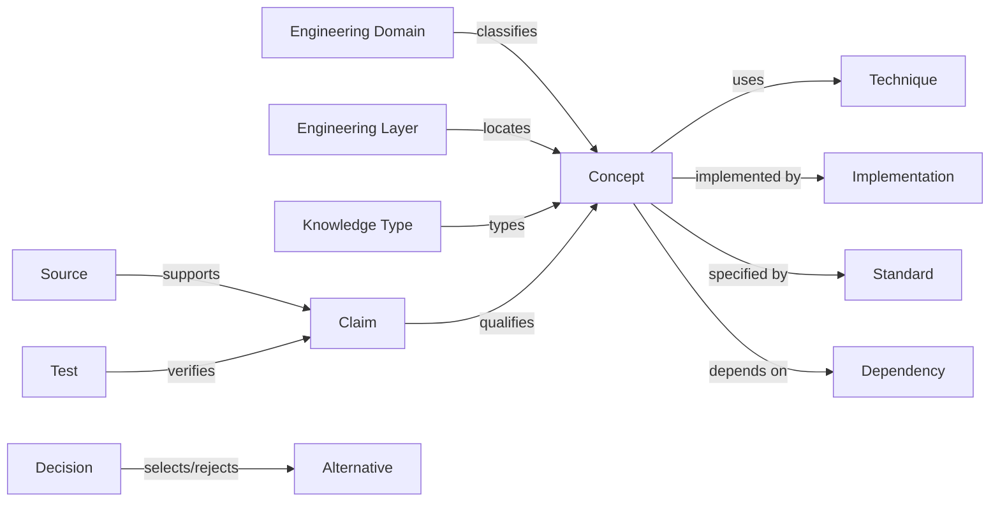

# Initial Knowledge Graph Model

Each edge should include subject ID, predicate, object ID, context, source/evidence ID, status, date, and optional version scope.

Future exports: JSON, JSON-LD, RDF/Turtle, GraphML, CSV node/edge tables, SVG/PNG. Generated outputs must be reproducible and identify source revision.
