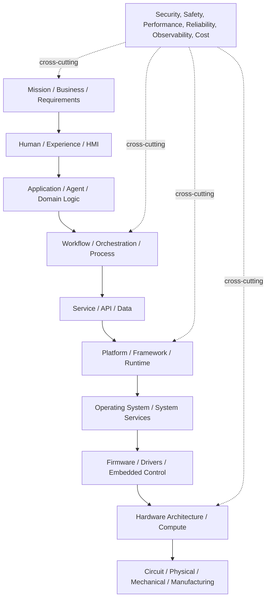

# Universal Engineering Stack

Conceptual cross-layer reference, not mandatory implementation architecture.

Layers group responsibilities; they are not necessarily separate processes or deployable units. Products may combine several layers. Cross-cutting qualities must be engineered and verified at multiple layers.
